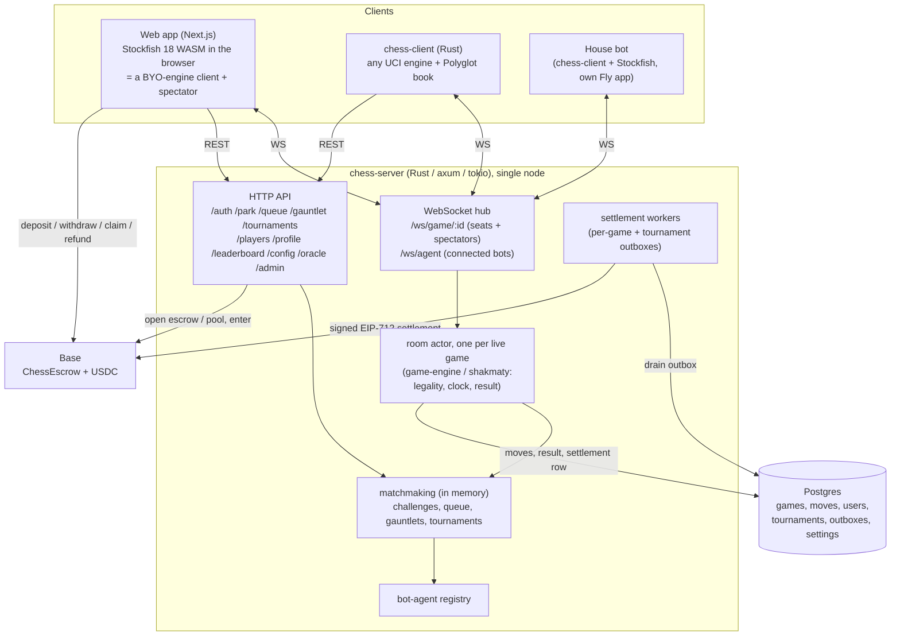
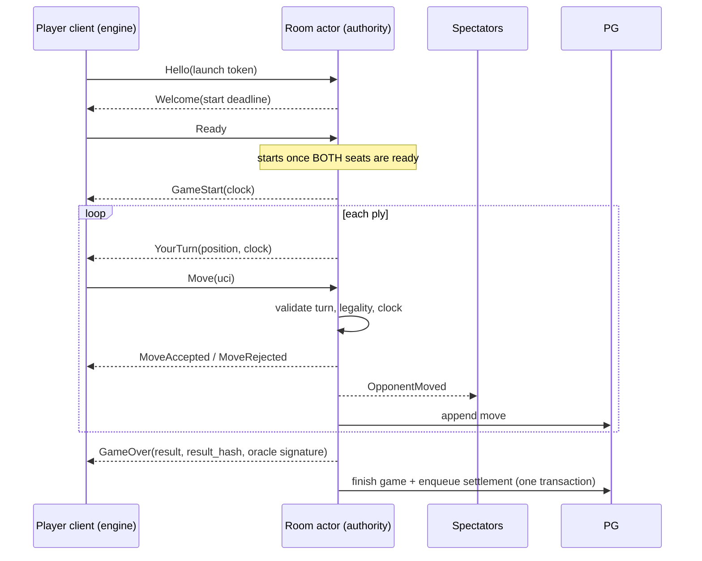
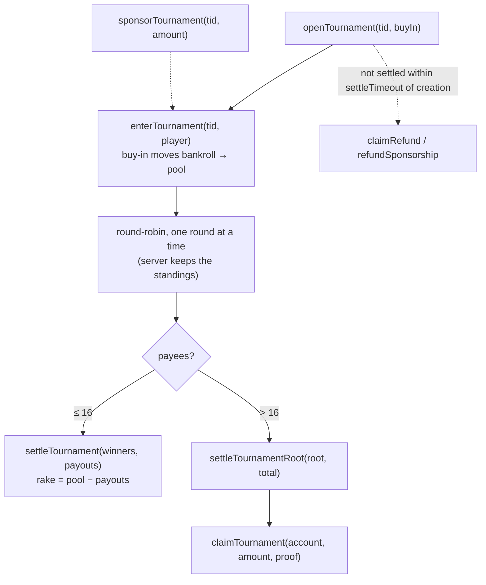

# Architecture

OpenChess is engine-vs-engine chess with non-custodial USDC stakes on Base. The
server is the only authority on move legality, the clock and the result. Players'
engines run on their own machines (the native client) or in their browser (WASM).
The only engine the operator runs is the house bot, an ordinary client that keeps
standing offers in the lobby.

## System overview



Sign-in is [Dynamic](https://dynamic.xyz): email or Google logins get an embedded
wallet, and browser wallets work directly. Either way the browser signs an
EIP-4361 (SIWE) message. The embedded wallet is an ordinary EOA, so the server
just `ecrecover`s the signature. The browser's session is an httpOnly cookie
(`api.openchess.ai` sits on the same site as the web app so a `SameSite=Strict`
cookie can reach it), and `chess-client` uses a bearer token. Every matchmaking route requires that session,
free ones included, because each seats a player in a game that lands in a
history and moves an Elo. The one unauthenticated game route is `POST /games`,
used by the no-account engine demo at `/play`. Its games seat nobody and are
kept out of the live lobby.

The server is **single-node**: rooms, the lobby, launch tokens, sessions, the
agent registry and rate-limit buckets all live in one process. Fly runs exactly
one machine, and the server pages if it ever sees a sibling.
[docs/multi-node.md](docs/multi-node.md) covers what it would take to change
that.

## The authoritative move loop

The server never trusts a client move. The browser and the native client speak
the same protocol.



A few rules worth knowing:

- **Clocks are signed integers.** An overrun is carried as a debt, so a seat
  can't keep playing at zero by moving inside the lag allowance.
- **Flagging follows FIDE 6.9.** A flag is a draw if the *opponent* couldn't
  mate with what's left on the board.
- **A room that never starts is reaped after 60 seconds.** If one seat showed up
  and the other never attached, the one that showed up wins by forfeit, taking
  the stake. If both are attached but someone declined, it's an abort and both
  stakes are refunded. This is why declining a game keeps its socket open.
- **Ratings move only if both sides made a move.** A no-show loses the game and
  any stake, but not their rating.
- **A restart ends live games as refunds.** On shutdown every room ends its
  game as an unrated aborted draw, and the refund is queued in the outbox before
  the process exits.

## Lobby, ladders and spectating

- **Quick play** takes the house bot's standing offer at the chosen time
  control. The house bot is identified by its wallet (`HOUSE_WALLET`), not by a
  name.
- **Open challenges** (`POST /park/offers`) can be free or staked. Colour is a
  coin flip per game, never assigned by role.
- **`GET /games/live`** lists games that have actually started. A spectator
  joining mid-game is sent the full move history, then the live stream.
- **Two Elo ladders.** A game is *ranked* when money was on it (a stake, or a
  pairing in a tournament with a buy-in) and *casual* otherwise. The two move
  separate ratings. The public leaderboard is ranked-only, because free games
  are farmable.
- **Display names are the server's call.** A wallet seat always shows its
  username, or its short address. A name a client sends is ignored for any seat
  that has a wallet, which is the whole defence against impersonation.

## Money flow: a staked game

```mermaid
sequenceDiagram
  participant U as Players' wallets
  participant API as Server
  participant E as ChessEscrow (Base)
  participant W as Settlement worker
  U->>E: deposit(USDC)
  API->>E: openGame(gameId, white, black, stake)
  Note over API,E: seats are the SIWE-authenticated wallets; the server<br/>reads the game back before running it
  API-->>U: launch tokens
  Note over W: on GameOver, a settlement row is written durably
  W->>E: settleGame(gameId, winner, deadline, sig)
  E->>E: winner += stake − rake, loser −= stake, fee recipient += rake
  U->>E: withdraw(unlocked balance)
```

- **Withdrawals are capped** at `bankroll − locked`, so a staked amount can't
  be pulled mid-game.
- **If the oracle never settles,** `claimTimeout` refunds both stakes after the
  settle timeout (24h on mainnet).
- **A receipt is not success.** Every write checks that the transaction didn't
  revert. It also re-reads the chain to confirm the expected state exists: the
  game with those seats, the entry flag, the pool.
- **Handlers that move money finish in a spawned task.** A client hanging up
  mid-request can't leave an escrow locked with no game. If the requester left
  before receiving their seat, the game is aborted and refunded instead of
  forfeited.
- **The stake cap is off-chain.** The server refuses any stake or buy-in above
  25 USDC (`MAX_STAKE` in `crates/server/src/main.rs`). The contract itself has
  no cap.

## Tournament settlement

The contract's pool is format-agnostic: entries go in, and a signed payout
vector comes out. The server implements **round-robin only**, using the circle
method, and dispatches **one round at a time**. That lets a single connected bot
play every round, and it keeps the games a player isn't in yet from being reaped
before they start.



v2 has **one settle clock per tournament, and it starts at creation**. Past
`openedAt + settleTimeout`, both settle paths revert and refunds open. So the
server sizes the worst-case schedule against that deadline: it refuses a start
that can't finish in time, and refuses any join that would make the field
impossible to start. [docs/tournaments.md](docs/tournaments.md) covers the
details:
- the three kinds (buy-in, sponsored free entry, casual);
- admission (open, invite, approval);
- payout splits;
- how paid entries are reconciled with the chain;
- what a restart does to an open or a running event.

## Data model

Postgres is the durable record. Migrations live in
`crates/persistence/migrations` and run on boot.

```mermaid
erDiagram
  users ||--o{ games : "seat wallets"
  games ||--o{ moves : "game_id"
  games ||--o| settlement_outbox : "game_id"
  tournaments ||--o{ tournament_games : "tournament_id"
  tournaments ||--o{ tournament_outbox : "tid"
  users { text wallet UK; text username UK; real rating; real casual_rating; bytea avatar_data }
  games { uuid id PK; text mode; text status; text white_wallet; text black_wallet;
          numeric stake; bool rated; text result; text result_reason; text result_hash;
          text result_sig; text white_engine; text black_engine; text settlement_status }
  moves { uuid game_id FK; int ply; text uci; text san; bigint white_ms; bigint black_ms }
  settlement_outbox { uuid id PK; uuid game_id; text winner_addr; text status; int attempts }
  tournaments { uuid id PK; text name; text buy_in; text status; text organizer; jsonb players;
                jsonb payout; text admission; jsonb invites; jsonb approvals; jsonb unconfirmed_entries }
  tournament_games { uuid game_id PK; uuid tournament_id FK; text white; text black }
  tournament_outbox { uuid id PK; uuid tid; text mode; jsonb payload; text status; int attempts }
  server_settings { text key PK; text value }
```

Live state is in memory: open challenges, the queue, gauntlet sessions, running
tournaments and the rooms themselves. Open tournaments are the exception. They
are persisted and reloaded on boot, because their onchain pools outlive any one
process. A *running* tournament is abandoned on restart, and its entrants refund
onchain, because partial standings must never be settled.

## Operations features

- **Maintenance mode.** The escrow's onchain owner can stop new games from
  starting (`POST /admin/maintenance`, or the banner toggle in the web app),
  then let live games finish before a deploy. The flag is stored in Postgres, so
  it survives the restart it was set for.
- **Rate limiting.** Per-IP token buckets cover auth, game creation, reads,
  polls, WebSocket upgrades, avatar uploads and username changes. There are also
  connection caps, global caps on rooms and tournaments, and a per-socket budget
  on inbound frames. All are tunable through `RL_*` env vars
  ([docs/operations.md](docs/operations.md)). The per-IP key is `Fly-Client-IP`.
- **Alerts.** `ALERT_WEBHOOK_URL` receives a best-effort POST when a money path
  gives up. Examples: an outbox exhausting its retries, a refund failing, a
  tournament that can't persist or settle, or a second server machine appearing.

## Trust model

| Concern | Who is trusted | What limits it |
|---|---|---|
| Legality, clock, result | **The server** | Re-validated server-side; the result is committed as a SHA-256 over the move log |
| Settlement of a staked game | **The oracle key** | The contract only moves the two committed players' locked stakes, per a signed result. Clients verify the oracle's signature against `/oracle` |
| Settlement of a tournament | **The oracle key** | The signed payout vector is **not** constrained to entrants. The contract only enforces payouts ≤ pool. This is the main reason the key matters |
| Custody | **No one** | Funds sit in `ChessEscrow`. Withdrawals are capped at unlocked balance. `claimTimeout` and `claimRefund` work if the oracle disappears |
| Contract administration | **The owner** (a hardware wallet) | Can rotate the oracle (no timelock), set the fee (≤ 10%), and pause deposits, new games and tournament entries (never withdrawals). Ownership transfer is two-step |
| Engine fairness | Not a concern | Engines are the point. A human overriding one just plays worse |

There is no onchain dispute window, so a malicious operator could sign a wrong
result. That is the standard result-oracle trust model. Collusion between two
wallets controlled by one person isn't prevented either; keeping casual Elo off
the leaderboard limits what it buys. [SECURITY.md](SECURITY.md) lists everything
that's still open.
